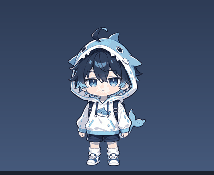

# 小鲸鱼桌宠

> 关键词：**小季** · 小鲸鱼 · 桌宠 · DeepSeek 拟人 · 正太 · 免费
>
> 一个 Windows 桌面宠物：会眨眼、会打盹、会听你说话，被你拎起来的时候一脸“诶？”。
>
> *A free Windows desktop pet — a chibi whale boy.*



---

## 下载

不想看代码的话，直接下 **[dist/小鲸鱼桌宠-v1.0.zip](dist/小鲸鱼桌宠-v1.0.zip)**，解压后双击 `安装.cmd`。

## 这是什么

来自抖音图文作品里分享的那只「小鲸鱼」，做成了能待在桌面右下角的小程序。

- **待机**：呼吸起伏，每 3～8 秒眨一次眼
- **点击**：Q 弹一下 + 换表情 + 说一句台词
- **拖拽**：被拎起来的姿势，松手落地会轻弹一下
- **聆听**：你一开麦（语音输入/语音通话），它会抬手指耳朵
- **打字**：你敲键盘时它会歪头
- **睡觉**：90 秒没人理，蜷着睡；点一下就醒
- **贴边**：拖到屏幕左右边缘松手，会扒着边偷看
- **右键**：说句话 / 打字干活 / 坐下歇会儿 / 睡一会儿 / 总在最前 / 退出
- **DSH 联动**（可选）：装了 DeepSeek Harness 的话，它会在你干活时自动切到“打字”状态

> 已知限制：贴到左右边界后，不再响应打字/聆听等状态；没有走路动画（只有原地动作）。

## 系统要求

- Windows 10 / 11
- 系统自带的 Windows PowerShell 5.1（不用额外安装）
- 不需要联网

## 安装

1. 把压缩包解压到任意位置（别直接双击压缩包里的文件）；
2. 双击 **`安装.cmd`**；
3. 如果 Windows 弹出「已保护你的电脑」（SmartScreen），点 **更多信息 → 仍要运行**；
4. 安装完成后，桌面会出现 **「小鲸鱼桌宠」** 快捷方式，程序会自动启动一次。

安装位置：`%LOCALAPPDATA%\XiaoJingYu`（不写注册表，不装服务）。

## 使用

- **左键点它**：Q 弹 + 说话
- **按住拖动**：拎起来，松手落地
- **拖到屏幕左右边缘**：扒边偷看
- **右键**：菜单

## 卸载

1. 先右键桌宠 → **退出**；
2. 双击 **`卸载.cmd`**（会自动删掉快捷方式和 `%LOCALAPPDATA%\XiaoJingYu`）。

也可以手动：删除桌面快捷方式 + 删除 `%LOCALAPPDATA%\XiaoJingYu` 文件夹。

## 隐私说明

程序会做两件“读状态”的事，**都不记录内容、不联网、不上传**：

1. 检测键盘**是否正在被按下**（用于“打字时歪头”），不读取键值、不保存字符；
2. 检测**麦克风是否被占用**（用于“聆听”动作），不录音、不保存音频。

如果你介意，可以右键退出后不再启动；程序没有任何后台自启动项。

## 想改点什么

- **改大小**：用记事本打开 `%LOCALAPPDATA%\XiaoJingYu\pet.ps1`，找到最上面的
  ```
  $PET_WIDTH = 180
  ```
  改数字（150～300），保存后重启桌宠。
- **换图**：替换 `frames\` 里的同名 PNG（保持 640×900、底部对齐）。

## 声明

- 本项目是**非官方个人二创**，基于 DeepSeek 鲸鱼形象的公开设定创作，与 DeepSeek 官方**无关联、未获授权**。
- **完全免费**，请勿用于商业用途，也不要二次打包售卖。
- 代码部分 MIT 许可；`frames/` 里的图片素材仅限个人非商业使用，详见 `LICENSE`。

喜欢的话，回到那条图文下面留个言就行。
